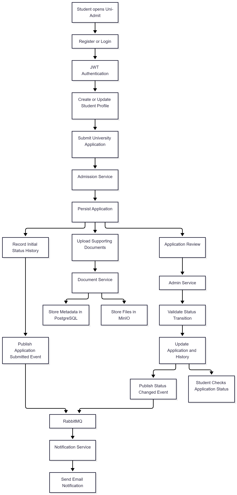
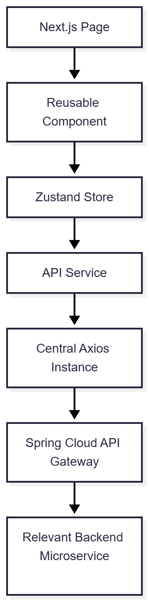

# Uni-Admit
### Cloud-Native University Admission Management Platform

**A full-stack university admission management system built with Next.js, Spring Boot microservices, PostgreSQL, RabbitMQ, MinIO, and Docker.**

Uni-Admit is a web-based university admission platform designed to streamline the student admission journey and simplify application administration. Students can create accounts, maintain their profiles, submit university applications, upload supporting documents, and track application progress. Administrative operations support application review, status management, and analytics.

The platform uses a distributed microservices architecture with centralized API routing, JWT-based authentication, service discovery, asynchronous event processing, and containerized infrastructure.

---

## Table of Contents

- [Overview](#overview)
- [Key Features](#key-features)
- [System Architecture](#system-architecture)
- [Technology Stack](#technology-stack)
- [Microservices](#microservices)
- [Application Workflow](#application-workflow)
- [Repository Structure](#repository-structure)
- [Getting Started](#getting-started)
- [Configuration](#configuration)
- [Service Endpoints](#service-endpoints)
- [Monitoring and Observability](#monitoring-and-observability)
- [Load Testing](#load-testing)
- [Security](#security)
- [Future Improvements](#future-improvements)
- [Contributing](#contributing)

---

## Overview

University admission processes often involve multiple disconnected activities, including student registration, profile collection, application submission, document handling, administrative review, and status communication.

Uni-Admit brings these activities together in one platform.

The system is organized around independently deployable backend services, each responsible for a specific business domain. A Spring Cloud API Gateway provides a centralized entry point for frontend requests, while Netflix Eureka supports service discovery.

PostgreSQL provides persistent storage for the individual service domains. RabbitMQ enables asynchronous communication for application-related events and notifications, while MinIO provides object storage for uploaded documents.

The frontend is developed using Next.js, React, and TypeScript, with Zustand for state management and Axios for API communication.

### Project Goals

- Simplify the university admission process through a centralized digital platform.
- Provide students with a structured application and document submission experience.
- Separate business responsibilities through domain-oriented microservices.
- Support secure, role-aware access to application resources.
- Reduce synchronous dependencies through asynchronous event processing.
- Improve service visibility through health checks and metrics.
- Provide a containerized environment for local development and integration.

---

## Key Features

### Student Portal

- Student registration and login.
- JWT-based authenticated access.
- Student profile creation and management.
- University application submission.
- Application listing and individual application retrieval.
- Application status tracking.
- Document upload, retrieval, and deletion.
- Student dashboard and application progress interface.

### Application Management

- Application submission with student and profile association.
- Application status management.
- Status transition validation.
- Application status history recording.
- Administrative review and comments.
- Rejection reason handling.
- Application-related event publishing.

### Document Management

- Multipart document uploads.
- Document metadata persistence.
- MinIO-based object storage.
- Pre-signed download URL generation.
- Document retrieval by student or application.
- Document deletion.
- File type and file size validation.

### Administrative Capabilities

- Retrieve all applications.
- Retrieve individual application details with student profile information.
- Review applications.
- Update application statuses.
- Retrieve application analytics.
- Role-based administrative authorization.

### Asynchronous Notifications

- User registration events.
- Application submission events.
- Application status change events.
- RabbitMQ-based message consumption.
- HTML email templates using Thymeleaf.

---

## System Architecture

Uni-Admit follows a distributed microservices architecture. The frontend communicates with backend services through a centralized API Gateway rather than calling individual microservices directly.


*The diagram represents the major architectural components and their responsibilities. It is a conceptual view, not a complete representation of every internal call or configuration.*

### Architectural Principles

| Principle | Implementation |
| :--- | :--- |
| Service separation | Independent Spring Boot services |
| Centralized routing | Spring Cloud API Gateway |
| Service discovery | Netflix Eureka |
| Authentication | JWT validation at the gateway |
| Data separation | PostgreSQL databases per service domain |
| Asynchronous communication | RabbitMQ |
| Object storage | MinIO |
| Resilience | Resilience4j |
| Observability | Spring Actuator, Micrometer, Prometheus and Grafana |
| Containerization | Docker and Docker Compose |
---

| Layer | Technologies |
| :--- | :--- |
| Frontend | Next.js 15, React 19, TypeScript |
| Styling and UI | Tailwind CSS 4, shadcn/ui, Lucide React |
| State Management | Zustand |
| API Communication | Axios |
| Form Management | React Hook Form, Zod |
| Backend | Java 21, Spring Boot 3.3.4 |
| Microservices | Spring Cloud |
| API Gateway | Spring Cloud Gateway |
| Service Discovery | Netflix Eureka |
| Inter-service Communication | OpenFeign |
| Authentication | Spring Security, JWT |
| Database | PostgreSQL 16 |
| ORM | Spring Data JPA, Hibernate |
| Messaging | RabbitMQ |
| Object Storage | MinIO |
| Resilience | Resilience4j |
| Monitoring | Spring Actuator, Micrometer, Prometheus, Grafana |
| Containerization | Docker, Docker Compose |
| Load Testing | k6 |
| Build Tools | Maven, npm |

---

## Microservices

The backend contains seven business/infrastructure services, alongside the shared Maven BOM.

| Service | Port | Responsibility |
| :--- | ---: | :--- |
| API Gateway | 8080 | Centralized routing, JWT validation, request forwarding |
| Authentication Service | 8081 | Registration, login, JWT and refresh-token operations |
| Profile Service | 8082 | Student profile creation, retrieval and updates |
| Admission Service | 8083 | Application submission, retrieval, status transitions and history |
| Document Service | 8084 | Document upload, metadata, retrieval and deletion |
| Notification Service | 8086 | RabbitMQ event consumption and email notifications |
| Admin Service | 8087 | Application review, administration and analytics |
| Eureka Server | 8070 | Service registration and discovery |

### Service Responsibilities

**1. Authentication Service**

- Handles student registration and login.
- Generates and validates authentication tokens.
- Supports refresh-token and logout operations.
- Uses Spring Security and JWT.

**2. Profile Service**

- Creates student profiles.
- Retrieves the authenticated student's profile.
- Supports profile updates.
- Uses OpenFeign for communication with other services where required.

**3. Admission Service**

- Accepts student application submissions.
- Retrieves applications by student or application ID.
- Validates application status transitions.
- Records status history.
- Publishes application-related events to RabbitMQ.
- Uses Resilience4j for resilience-related handling.

**4. Document Service**

- Accepts multipart document uploads.
- Stores document metadata in PostgreSQL.
- Stores file objects in MinIO.
- Generates pre-signed download URLs.
- Supports document retrieval and deletion.

**5. Notification Service**

- Consumes user registration, application submission, and status change events.
- Retrieves student email information.
- Generates email content using Thymeleaf templates.
- Sends email notifications through Spring Mail.

**6. Admin Service**

- Retrieves application information.
- Combines application and student profile details.
- Supports application review and status updates.
- Provides application analytics.
- Uses role checks to restrict administrative operations.

**7. API Gateway and Eureka**

- API Gateway provides a single backend entry point.
- JWT claims are validated and user identity/role headers are propagated to downstream services.
- Eureka maintains the service registry used for service discovery.

---

## Application Workflow

The following diagram illustrates the primary student application journey.



### Application Statuses

The backend defines the following application statuses:

| Status | Description |
| :--- | :--- |
| `DRAFT` | Application draft |
| `SUBMITTED` | Application submitted |
| `DOCUMENTS_PENDING` | Documents are pending |
| `UNDER_REVIEW` | Application is under review |
| `ACCEPTED` | Application accepted |
| `REJECTED` | Application rejected |
The Admission Service validates status transitions and maintains a status history for application tracking.

---

## Repository Structure

The repository is organized as a full-stack monorepo.

```text
uni-admit/
│
├── docker-compose.yml
│
├── uni-admit-backend/
│   ├── uni-admit-bom/
│   ├── api-gateway/
│   ├── eurekaserver/
│   ├── auth-service/
│   ├── profile-service/
│   ├── admission-service/
│   ├── document-service/
│   ├── notification-service/
│   └── admin-service/
│
├── uni-admit-frontend/
│   └── uni-admit-frontend/
│       ├── public/
│       └── src/
│           ├── app/
│           ├── components/
│           ├── lib/
│           ├── services/
│           ├── store/
│           ├── types/
│           └── validations/
│
├── monitoring/
│   ├── prometheus.yaml
│   └── grafana/
│       └── provisioning/
│
├── load-tests/
│   ├── admission_peak.js
│   └── circuit_breaker_demo.js
│
└── README.md
```

### Frontend Organization

| Directory | Responsibility |
| :--- | :--- |
| `app/` | Next.js routes and pages |
| `components/` | Reusable interface components |
| `lib/` | Axios configuration, authentication and utilities |
| `services/` | Backend API communication |
| `store/` | Zustand state management |
| `types/` | TypeScript interfaces and API contracts |
| `validations/` | Zod validation schemas |

The frontend uses a layered API communication approach:



This separation keeps UI components focused on presentation and user interaction while API communication and application state remain in their respective layers.

---

## Getting Started

### Prerequisites

Install the following tools before starting:

- Git
- Docker Desktop with Docker Compose
- Node.js 20 or later
- npm
- Java 21 (required for local backend builds outside Docker)
- A modern web browser

Docker is used to run the backend infrastructure and microservices. The frontend is started separately using npm.

### 1. Clone the Repository

```bash
git clone <YOUR_REPOSITORY_URL>
cd uni-admit
```

Replace `<YOUR_REPOSITORY_URL>` with the repository's actual Git URL.

### 2. Start Backend Services and Infrastructure

From the repository root, run:

```bash
docker compose up --build -d
```

This builds and starts the configured backend services and infrastructure, including:

- PostgreSQL databases
- RabbitMQ
- MinIO
- Eureka Server
- Authentication Service
- Profile Service
- Admission Service
- Document Service
- Notification Service
- Admin Service
- API Gateway
- Prometheus
- Grafana

Check container status:

```bash
docker compose ps
```

Follow logs:

```bash
docker compose logs -f
```

To inspect a particular service:

```bash
docker compose logs -f api-gateway
```

### 3. Start the Frontend

Open another terminal:

```bash
cd uni-admit-frontend/uni-admit-frontend
```

Install dependencies:

```bash
npm install
```

Start the development server on port `3001`:

```bash
npm run dev -- --port 3001
```

The frontend's Next.js rewrite configuration forwards `/api/*` requests to the local API Gateway at `http://localhost:8080`.

Open:

**http://localhost:3001**

### 4. Verify the Environment

| Component | Local URL |
| :--- | :--- |
| Uni-Admit Frontend | http://localhost:3001 |
| API Gateway | http://localhost:8080 |
| Eureka Dashboard | http://localhost:8070 |
| MinIO Console | http://localhost:9001 |
| RabbitMQ Management | http://localhost:15672 |
| Prometheus | http://localhost:9090 |
| Grafana | http://localhost:3000 |

The Eureka dashboard and service health endpoints can help verify service registration and availability.

### 5. Stop the Environment

Stop containers:

```bash
docker compose down
```

Stop containers and remove persisted Docker volumes:

```bash
docker compose down -v
```

**Warning:** The second command deletes the named database, messaging, object-storage, and monitoring volumes. Use it only when you intentionally want to reset local data.

---

## Configuration

### Frontend

The frontend Axios instance uses:

```text
NEXT_PUBLIC_API_BASE_URL
```

If it is not provided, the configured default is `/api`.

The Next.js rewrite forwards API requests to:

```text
http://localhost:8080
```

### Backend

Backend services provide separate local and Docker profile configuration files:

- `application.yaml`
- `application-docker.yml`

Docker Compose activates the `docker` Spring profile for the services it starts.

The Docker environment uses service/container names for internal communication, while local configuration uses localhost addresses.

### Important Security Note

The uploaded repository contains development-oriented configuration defaults. Before deploying or sharing a public production environment:

- Move passwords, JWT signing secrets, SMTP credentials and storage credentials into environment variables or a secrets manager.
- Replace default database, RabbitMQ, MinIO and Grafana credentials.
- Never commit `.env` files, access tokens, private keys or production credentials.
- Configure production CORS origins explicitly.
- Use HTTPS and secure infrastructure networking.
- Review logging to ensure sensitive information is not exposed.

The supplied Docker Compose configuration is intended for local development and demonstration, not as a production-hardened deployment.

---

## Service Endpoints

The following routes are exposed through the API Gateway.

| Domain | Method | Endpoint | Purpose |
| :--- | :--- | :--- | :--- |
| Authentication | `POST` | `/auth/register` | Register a user |
| Authentication | `POST` | `/auth/login` | Authenticate a user |
| Authentication | `POST` | `/auth/refresh` | Refresh authentication |
| Authentication | `POST` | `/auth/logout` | Log out |
| Profile | `POST` | `/profile` | Create a profile |
| Profile | `GET` | `/profile/me` | Retrieve own profile |
| Profile | `PUT` | `/profile/me` | Update own profile |
| Admission | `POST` | `/application` | Submit an application |
| Admission | `GET` | `/application/my` | Retrieve own applications |
| Admission | `GET` | `/application/{applicationId}` | Retrieve an application |
| Documents | `POST` | `/docs/upload` | Upload a document |
| Documents | `GET` | `/docs/my` | Retrieve own documents |
| Documents | `GET` | `/docs/{documentId}` | Retrieve document metadata |
| Documents | `GET` | `/docs/application/{applicationId}` | Retrieve application documents |
| Documents | `DELETE` | `/docs/{documentId}` | Delete a document |
| Administration | `GET` | `/admin/applications` | Retrieve all applications |
| Administration | `GET` | `/admin/applications/{applicationId}` | Retrieve application details |
| Administration | `PATCH` | `/admin/applications/{applicationId}/review` | Review an application |
| Administration | `GET` | `/admin/analytics` | Retrieve application analytics |

Protected endpoints require a valid Bearer token. Administrative operations additionally require the appropriate role.

---

## Monitoring and Observability

Uni-Admit includes a monitoring setup based on Prometheus and Grafana.

### Prometheus

Prometheus is configured to scrape metrics from:

- API Gateway
- Eureka Server
- Authentication Service
- Profile Service
- Admission Service
- Document Service
- Notification Service
- Admin Service

The services expose metrics through Spring Boot Actuator and Micrometer.

### Grafana

Grafana is included in Docker Compose for metrics visualization and dashboard-based monitoring.

### Health Checks

Docker Compose defines health checks for key infrastructure components and backend services to help manage startup dependencies and service readiness.

---

## Load Testing

The repository includes k6 scripts for experimenting with application-service performance and resilience behavior.

### Admission Peak Load Test

File:

```text
load-tests/admission_peak.js
```

This script simulates users repeatedly retrieving their applications through the API Gateway.

The configured stages ramp up to 1,500 virtual users.

Configured thresholds:

- 95th percentile request duration below 3 seconds.
- HTTP request failure rate below 5%.

Run:

```bash
k6 run load-tests/admission_peak.js
```

### Circuit Breaker Demonstration

File:

```text
load-tests/circuit_breaker_demo.js
```

This script supports a demonstration of application API behavior while the Admission Service is unavailable and after it recovers.

Run:

```bash
k6 run load-tests/circuit_breaker_demo.js
```

The scripts contain demonstration test-account and test-data assumptions. Configure valid test credentials and data in a controlled environment before running them.

**Note:** The presence of load-test scripts and configured thresholds does not, by itself, establish that the thresholds have been achieved. Record actual test results separately when reporting performance.

---

## Security

Security-related mechanisms implemented in the project include:

- JWT-based authentication.
- Centralized token validation at the API Gateway.
- User identity and role propagation through request headers.
- Spring Security integration.
- Role checks for administrative operations.
- Validation of incoming request data.
- Document file type and file size validation.
- Separation of service data domains.

The API Gateway validates incoming JWTs and injects authenticated user information into downstream request headers. Backend services use this information to identify the requesting student or administrator.

Production deployment requires additional security hardening, secrets management, HTTPS, access-control review, and infrastructure configuration.

---

## Future Improvements

Potential areas for further development include:

- Automated CI/CD pipelines.
- Centralized log aggregation and distributed tracing.
- Production-grade secrets management.
- Automated integration and end-to-end testing.
- Expanded monitoring dashboards and alerting.
- Rate limiting and API abuse protection.
- More comprehensive document verification workflows.
- Production deployment using an orchestrator such as Kubernetes.
- Improved service-to-service authorization and network policies.

These are possible future enhancements, not claims about the current implementation.

---

## Contributing

Contributions that improve reliability, maintainability, security, documentation, and test coverage are welcome.

A typical contribution workflow:

1. Fork the repository.
2. Create a feature branch.
3. Implement the change.
4. Run relevant tests and lint checks.
5. Submit a pull request with a clear description.

---

## Project Information

**Project:** Uni-Admit – University Admission Management System  
**Architecture:** Full-Stack Distributed Microservices  
**Backend:** Java, Spring Boot, Spring Cloud  
**Frontend:** Next.js, React, TypeScript  
**Infrastructure:** Docker, PostgreSQL, RabbitMQ, MinIO  
**Monitoring:** Prometheus and Grafana

---

*Uni-Admit aims to demonstrate how a modern web application can organize a multi-stage university admission process using a modular frontend, domain-oriented backend services, asynchronous communication, and containerized infrastructure.*
